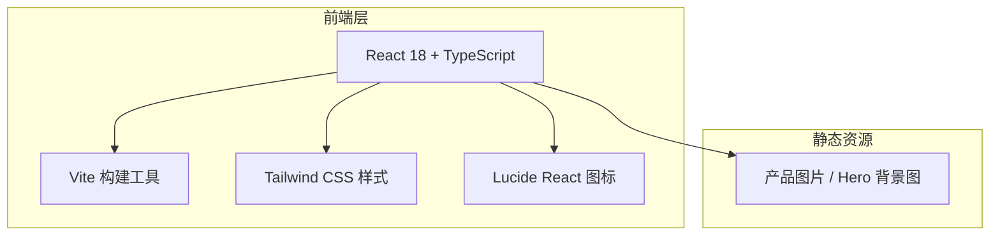

## 1. 架构设计



## 2. 技术说明

- **前端框架**：React 18 + TypeScript
- **构建工具**：Vite 5.x
- **样式方案**：Tailwind CSS 3.x + CSS Variables（设计令牌）
- **图标库**：Lucide React
- **路由**：React Router DOM（单页面，预留扩展能力）
- **状态管理**：Zustand（轻量级，当前页面复杂度下可选）
- **后端**：无（纯静态展示页面）
- **数据库**：无
- **部署方式**：静态资源部署

## 3. 路由定义

| 路由 | 用途 |
|------|------|
| / | 首页（Hero + 核心优势 + 产品 + 关于 + 页脚） |

## 4. 目录结构

```
src/
├── components/           # 可复用组件
│   ├── Navbar.tsx       # 导航栏组件
│   ├── Hero.tsx         # Hero 主视觉组件
│   ├── Advantages.tsx   # 核心优势组件
│   ├── Products.tsx     # 产品展示组件
│   ├── About.tsx        # 关于我们组件
│   └── Footer.tsx       # 页脚组件
├── pages/               # 页面组件
│   └── Home.tsx         # 首页
├── styles/              # 全局样式
│   └── index.css        # 全局样式 + Tailwind 指令
├── App.tsx              # 应用根组件
├── main.tsx             # 入口文件
└── vite-env.d.ts        # Vite 类型声明
```

## 5. 组件拆分原则

- **单一职责**：每个组件专注一个功能区块
- **可复用性**：卡片、按钮等基础 UI 模式保持统一
- **Props 驱动**：通过 props 传递数据，便于后续接入真实数据
- **类型安全**：所有组件使用 TypeScript 类型定义

## 6. 性能优化

- 图片懒加载（loading="lazy"）
- CSS 动画优先使用 transform 和 opacity 属性
- 组件按需渲染，避免不必要的重渲染
- 使用 Tailwind 的 JIT 模式减少 CSS 体积
- 图标按需导入

## 7. 响应式断点

沿用 Tailwind 默认断点体系，设计稿以桌面端为准：
- `sm`: 640px - 手机横屏/小平板
- `md`: 768px - 平板
- `lg`: 1024px - 小桌面/大平板
- `xl`: 1280px - 标准桌面
- `2xl`: 1536px - 大桌面

## 8. 设计令牌（CSS Variables）

在 `:root` 中定义全局设计令牌，确保全站一致性：
- 颜色系统：主色、辅助色、强调色、文本色、背景色、边框色
- 字体系统：字体族、字号、字重、行高、字间距
- 间距系统：1-24 级间距刻度
- 圆角系统：sm/md/lg/xl/full
- 阴影系统：sm/md/lg/float/card-hover
- 动效系统：fast/base/slow 三档过渡时长
